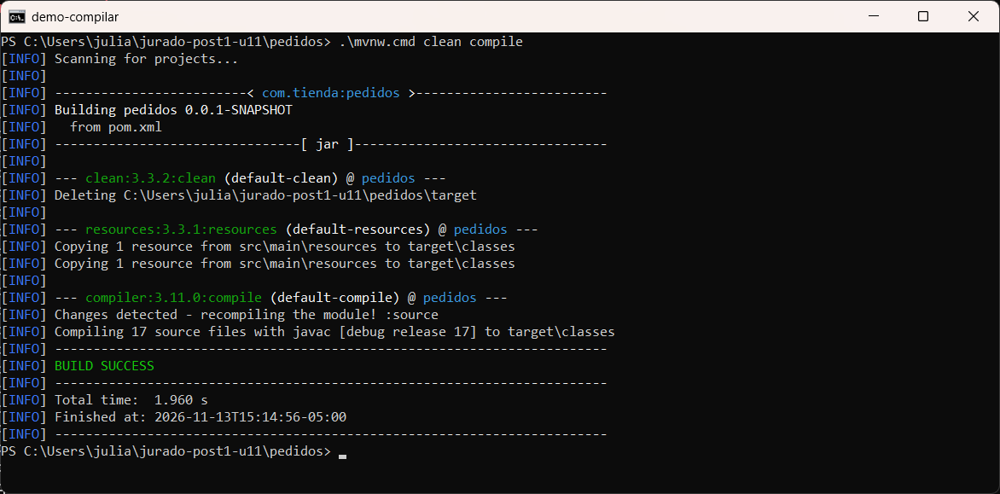
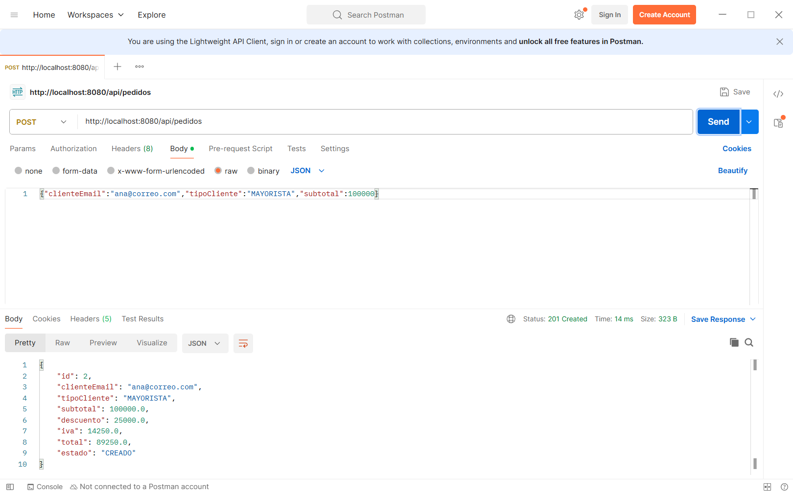
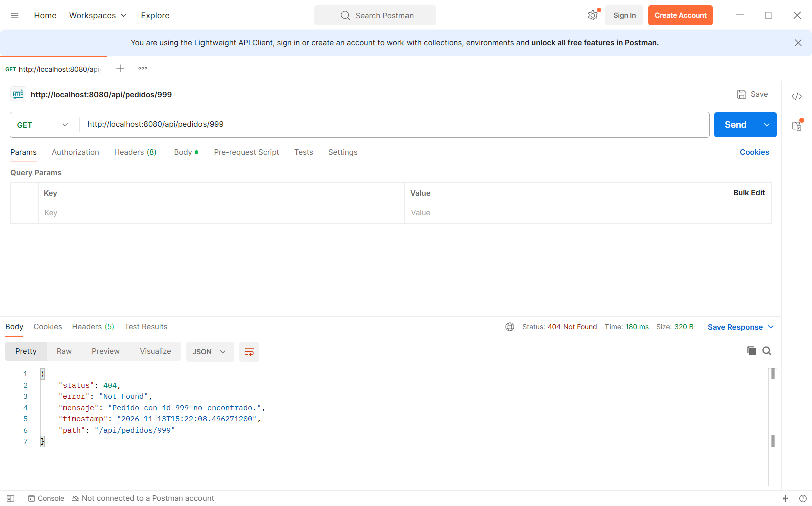
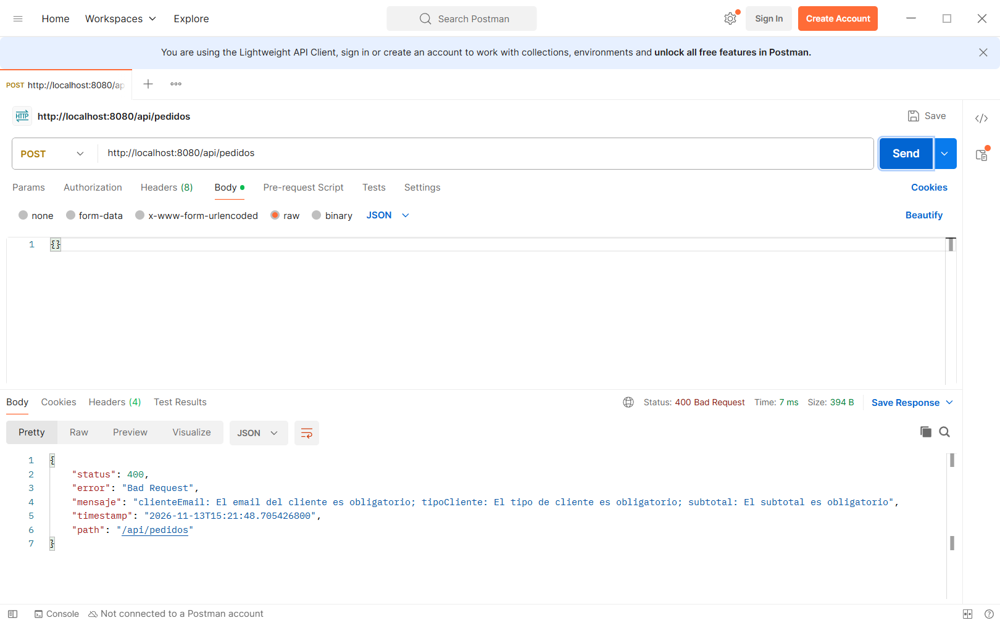
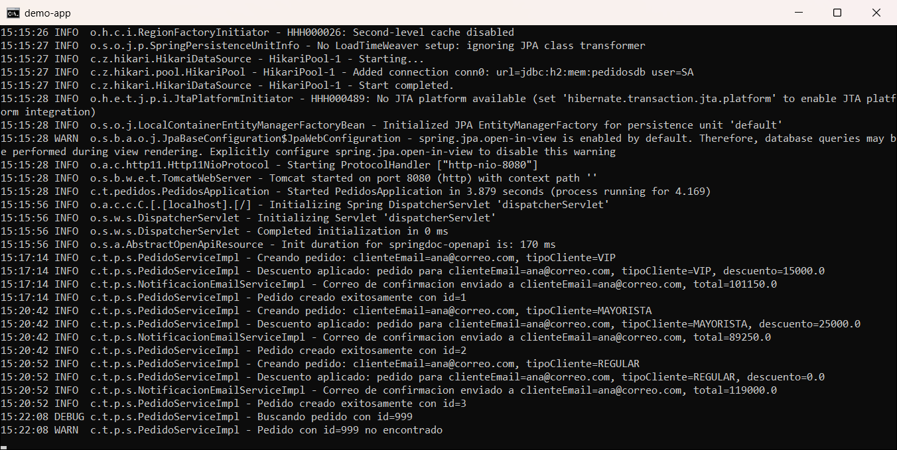
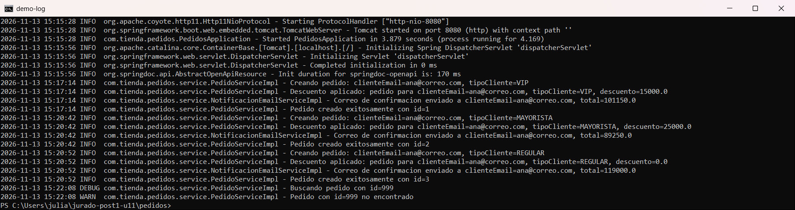
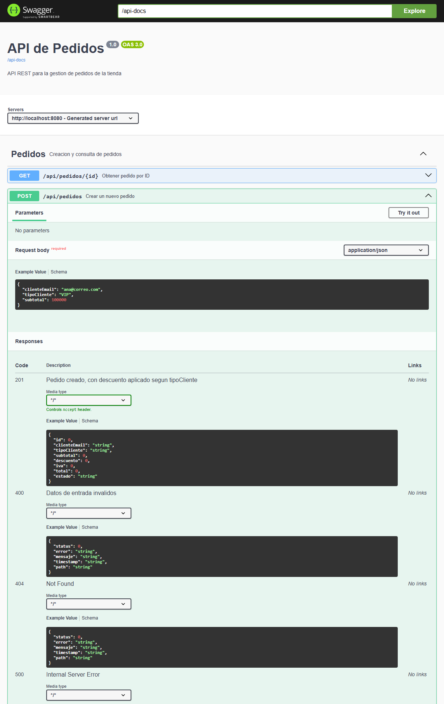

# Post-contenido Unidad 11: refactorización con SOLID, DTO y Strategy

## Descripción
Repositorio del laboratorio de la Unidad 11 de Programación Web (séptimo semestre). Contiene un único proyecto Maven Spring Boot, `pedidos/`, un sistema de gestión de pedidos de una tienda en línea. El proyecto parte de un código funcional pero mal diseñado: el controlador valida, calcula, escribe SQL a mano, notifica y registra todo en un solo método, y devuelve la entidad JPA completa. La Parte 1 lo refactoriza con arquitectura en capas, principios SOLID (SRP y DIP), el patrón DTO y el patrón Strategy para el descuento por tipo de cliente. La Parte 2 endurece el mismo proyecto con manejo centralizado de errores (`@RestControllerAdvice`), logging con SLF4J y Logback, y documentación de la API con springdoc-openapi (Swagger UI).

## Arquitectura resultante
```
controller/PedidoController
      |  depende de la interfaz, no de la implementación (DIP)
      v
service/PedidoService  <<interface>>
      ^
      |  implementa
service/PedidoServiceImpl
      |-- repository/PedidoRepository  ----------> entity/Pedido
      |-- service/NotificacionService  <<interface>>
      |         ^
      |         '-- service/NotificacionEmailServiceImpl
      '-- Map<String, EstrategiaDescuento>   (strategy/)
                |-- "REGULAR"   DescuentoRegular    0 %
                |-- "VIP"       DescuentoVip       15 %
                '-- "MAYORISTA" DescuentoMayorista 25 %

dto/PedidoRequestDTO   entrada, con Bean Validation
dto/PedidoResponseDTO  salida, sin notasInternas

exception/GlobalExceptionHandler  ->  ApiError
exception/RecursoNoEncontradoException
```

## Violaciones del código de partida y cómo se corrigieron
| Violación en el código de partida | Corrección |
|---|---|
| SRP: `crearPedido` validaba, calculaba el descuento, construía el SQL, persistía, notificaba y registraba en un solo bloque. | Cada responsabilidad tiene su clase: `PedidoRequestDTO` valida, `EstrategiaDescuento` calcula el descuento, `PedidoRepository` persiste, `NotificacionService` notifica y `PedidoServiceImpl` solo orquesta. |
| DIP: `NotificacionEmailService` se creaba con `new` dentro del controlador. | El controlador depende de la interfaz `PedidoService`, y `PedidoServiceImpl` recibe por constructor el repositorio, la interfaz `NotificacionService` y el mapa de estrategias. No queda ningún `new` de un colaborador. |
| Sin capa de acceso a datos: SQL concatenado en el controlador, con riesgo de inyección SQL. | `PedidoRepository` extiende `JpaRepository`. No hay ninguna sentencia SQL escrita a mano. |
| Entidad expuesta: la API devolvía `Pedido` completo, incluido `notasInternas`. | `PedidoRequestDTO` y `PedidoResponseDTO` reemplazan a la entidad. El DTO de salida no declara `notasInternas`, y el mapeo es explícito en `toResponseDTO`. |
| Manejo de errores disperso: un `try/catch` silenciaba la excepción con `println` y devolvía 200 con cuerpo vacío para un id inexistente. | El servicio lanza `RecursoNoEncontradoException` y `GlobalExceptionHandler` la convierte en un 404 con cuerpo `ApiError`. |
| Descuento con `if/else` en el controlador. | Patrón Strategy: tres implementaciones registradas como beans con nombre e inyectadas como `Map<String, EstrategiaDescuento>`. Agregar un tipo de cliente nuevo no obliga a modificar el servicio. |
| Registro con `System.out.println`. | Logger SLF4J en `PedidoServiceImpl` y `NotificacionEmailServiceImpl`, con `logback-spring.xml`. |

## Parte 1: refactorización con SOLID, DTO y Strategy
Los commits van en el orden en que se aplicó cada cambio: proyecto de partida, DTO y repositorio, servicio con inyección por constructor, y Strategy. El POST con un cliente VIP de 100000 devuelve 201 con descuento 15000, IVA 16150 y total 101150. Con MAYORISTA el descuento es 25000 y con REGULAR es 0.

## Parte 2: manejo de errores, logging y documentación
`GlobalExceptionHandler` atiende `RecursoNoEncontradoException` (404), `MethodArgumentNotValidException` (400) y la excepción genérica (500), sin ningún `try/catch` en el controlador. `PedidoServiceImpl` registra con placeholders y niveles INFO, DEBUG y WARN. `logback-spring.xml` define un appender de consola y un `RollingFileAppender` con rotación diaria y 30 días de historial en `logs/pedidos.log`. springdoc-openapi documenta la API con `@OpenAPIDefinition`, `@Tag`, `@Operation`, `@ApiResponse`, `@Parameter` y `@Schema`.

## Decisiones de diseño
- `JpaRepository` en lugar de `JdbcTemplate` (Parte 1): el código de partida concatenaba SQL a mano, lo que abría la puerta a la inyección SQL y obligaba a mantener las sentencias sincronizadas con la entidad. Con Spring Data JPA no se escribe SQL y las consultas derivadas, como `findByClienteEmail`, se verifican al compilar.
- Strategy en lugar de un segundo patrón creacional (Parte 1): el descuento es la variación real de comportamiento del dominio y puede crecer sin tocar `PedidoServiceImpl` (principio abierto/cerrado). La conversión entidad a DTO es un mapeo 1:1 sin condiciones, así que se resuelve con un método privado en el servicio en vez de agregar una clase Factory o Mapper.
- El descuento aplicado se registra en un único punto (Parte 2): `PedidoServiceImpl` escribe un solo mensaje INFO justo después de invocar la estrategia. Si cada estrategia tuviera su propio logger, el rastro de auditoría del descuento quedaría repartido en tres clases.
- `notasInternas` nunca se registra ni se expone (Parte 2): es información operativa de logística. Los mensajes de log solo incluyen identificadores y montos, ya que el archivo puede compartirse con soporte o conservarse 30 días.

## Ajustes sobre el enunciado
Estos cambios no están en el enunciado y se hicieron al probar casos límite.
- `PedidoRequestDTO.subtotal` lleva `@NotNull` además de `@Positive`, porque `@Positive` acepta un valor ausente. Sin esto, un POST sin subtotal terminaba en un `NullPointerException` y respondía 500 en vez de 400.
- `PedidoRequestDTO.tipoCliente` lleva `@Pattern` (REGULAR, VIP o MAYORISTA, sin distinguir mayúsculas). Sin esto, un tipo inventado como "ORO" se calculaba como REGULAR pero se guardaba como "ORO".
- `GlobalExceptionHandler` tiene dos handlers más, para un JSON mal formado y para un parámetro de ruta con tipo inválido (por ejemplo `/api/pedidos/abc`). Son errores del cliente y respondían 500.
- El handler genérico deja pasar las excepciones HTTP del propio framework. Sin esto, una ruta inexistente respondía 500 en vez de 404 y un método no permitido respondía 500 en vez de 405. Además registra con `log.error` los errores inesperados, que de otro modo no dejarían rastro.
- `NotificacionEmailServiceImpl` usa SLF4J en lugar de `System.out.println`, para que no quede ningún `println` en el proyecto.
- El enunciado nombra `NotificacionEmailService` en el código de partida pero no incluye su código. Se escribió una versión mínima que solo imprime el mensaje.
- El proyecto de partida se versionó en el primer commit, con `PedidosApplication`, el wrapper de Maven y un `.gitignore` que excluye `logs/`. Spring Boot es la 3.2.12, porque start.spring.io ya no ofrece ninguna 3.x.

Limitación conocida: un `subtotal` como `1e999` se interpreta como infinito, pasa `@Positive` y produce un total `NaN`. Se trata de una entrada fuera de rango que no se validó.

## Cómo compilar y ejecutar
Requisitos: JDK 17 o superior. Maven viene incluido con el wrapper `mvnw`.

1. Clonar el repositorio: `git clone https://github.com/julianejurado-rgb/jurado-post1-u11.git`
2. Entrar al proyecto: `cd jurado-post1-u11/pedidos`
3. Compilar: `./mvnw clean compile` (en Windows, `.\mvnw.cmd clean compile`)
4. Ejecutar: `./mvnw spring-boot:run`. La consola debe mostrar "Started PedidosApplication".
5. Probar los endpoints con Postman o curl en `http://localhost:8080/api/pedidos`. Los datos se guardan en H2 en memoria y se pierden al reiniciar.
6. Consultar los logs en la consola y en `pedidos/logs/pedidos.log`.
7. Abrir la documentación interactiva en `http://localhost:8080/swagger-ui.html`. La API expone `POST /api/pedidos` y `GET /api/pedidos/{id}`.

Ejemplo de creación:

```
curl -X POST http://localhost:8080/api/pedidos -H "Content-Type: application/json" -d '{"clienteEmail":"ana@correo.com","tipoCliente":"VIP","subtotal":100000}'
```

## Capturas de pantalla
Compilación exitosa:



Parte 1, Strategy con los tres tipos de cliente. POST de un cliente VIP, con descuento de 15000:


POST de un cliente MAYORISTA, con descuento de 25000:



POST de un cliente REGULAR, sin descuento:


Parte 2, manejo de errores. GET de un pedido inexistente, con 404 y el cuerpo `ApiError`:



POST con cuerpo vacío, con 400 y los mensajes de validación:



Logs en la consola con el formato SLF4J:



Archivo `logs/pedidos.log`, con la fecha completa:



Swagger UI con el endpoint POST expandido y sus respuestas:


